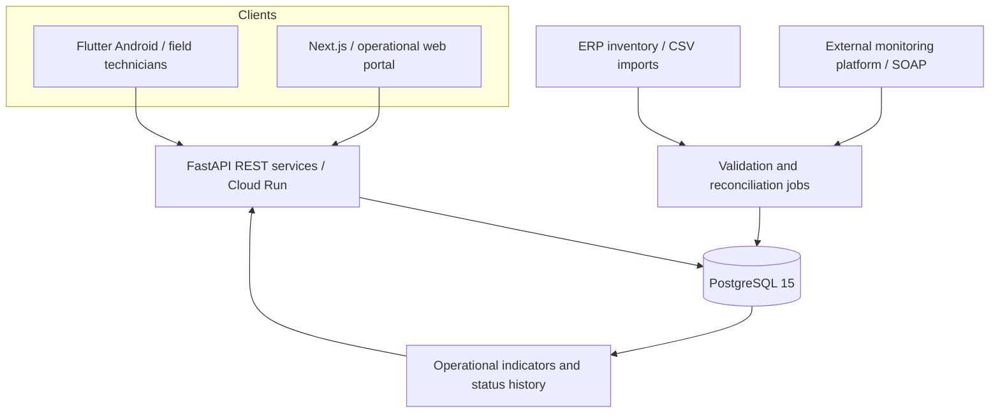
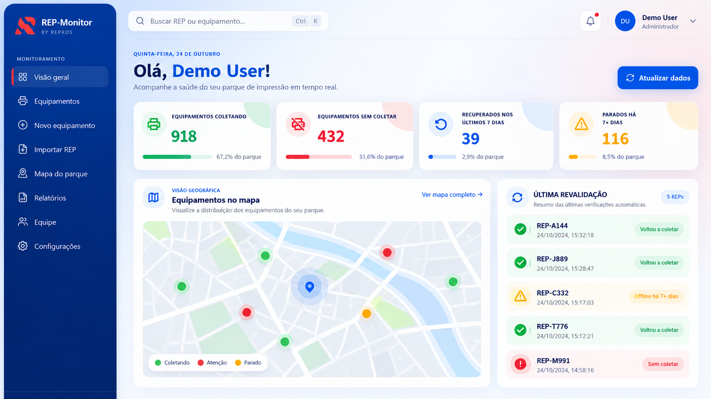
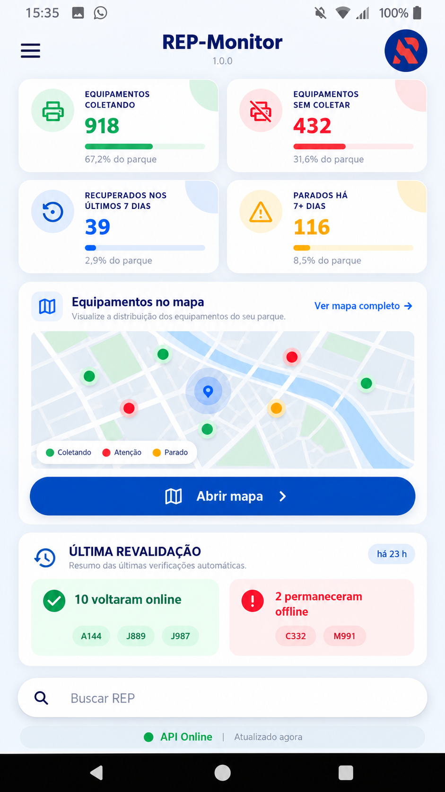
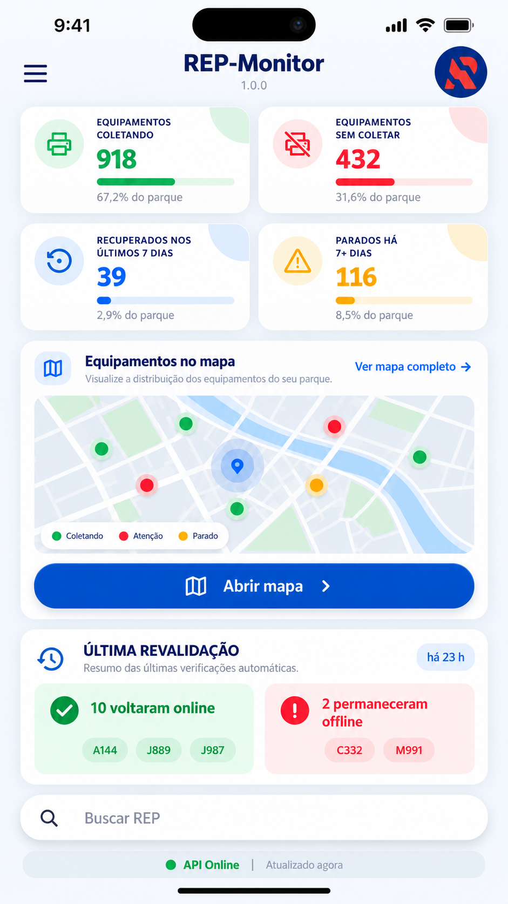

# REP-Monitor — Enterprise Fleet Monitoring
### Software Engineering · Mobile & Web · APIs · Data Engineering · Cloud Operations

**[🌐 Live interactive demo](https://walacevicente-cotokas.github.io/rep-monitor-case-study/demo/) | [Português](README.pt-BR.md) | [Demo source](demo/index.html) | [Architecture](docs/architecture.md) | [Engineering decisions](docs/engineering-decisions.md) | [Sanitized code](examples/) | [Author's profile](https://github.com/walacevicente-cotokas)**

> A documented case study of an enterprise monitoring solution. This is **not** the production source repository or a public production demo.

## The problem

Field technicians and supervisors needed a faster way to locate printing devices, identify stale telemetry, reconcile ERP inventories with monitoring data, and initiate diagnosis from a mobile-friendly interface. Disconnected systems and inconsistent equipment identifiers made the workflow difficult.

## The solution

REP-Monitor connects **a Flutter Android app, a Next.js web portal, a Python/FastAPI backend, PostgreSQL, and monitoring/ERP data**. It provides search by asset identifier or serial number, collection status, operational indicators, geographic views of problematic locations, revalidation workflows, and administrative controls.

### System overview

*Illustrative architecture, deliberately omitting internal network details, hosts and credentials.*

## Product interfaces — sanitized visual walkthrough

The images below are **sanitized, AI-assisted visual mockups** inspired by the product's interface and information architecture. Metrics, identifiers and geography are fictional; these are not production screenshots. The iOS image is a **design concept only**, not evidence of a tested or released iOS application.

### Web Dashboard

### Android Application

  

### iOS — Concept Preview

  

> **Portfolio mockups:** All images use fictional data. The iOS interface is a visual proposal, not a released app.

[Explore the interactive portfolio demonstration →](https://walacevicente-cotokas.github.io/rep-monitor-case-study/demo/)

## What was built

| Area | Capabilities | Engineering evidence |
| --- | --- | --- |
| **Mobile** | Flutter UI, authenticated search, status details, geolocation and clustered map | [Mobile and web](docs/product-features.md) |
| **Web** | Next.js dashboard, reports, search, account administration and import review | [Mobile and web](docs/product-features.md) |
| **Backend** | FastAPI endpoints, REST integration, individual revalidation, authentication and security controls | [Architecture](docs/architecture.md) |
| **Data** | PostgreSQL relational data, ERP/monitoring reconciliation, status history, incremental collection patterns | [Engineering decisions](docs/engineering-decisions.md) |
| **Operations** | Containerized deployment on Cloud Run; network integration and scheduled Windows/PowerShell processes | [Architecture](docs/architecture.md) |

## Key technical challenges

- **Data quality:** ERP records and telemetry could disagree by serial number or asset identifier. Import review and normalization help avoid false equipment reactivations.
- **Operational signal:** Status snapshots and transition history distinguish a recently recovered device from one with prolonged telemetry loss.
- **Field performance:** The map prioritizes problematic locations and limits rendered locations to a nearby subset rather than plotting the full fleet.
- **Security:** Separate application credentials, password hashing, role-based permissions, session invalidation, and login rate limits.
- **Maintainability:** Documentation of database objects, integration boundaries, and API behavior reduces unnecessary schema changes.

Read the [technical decision log](docs/engineering-decisions.md).

## Interactive portfolio prototype

Explore the [interactive synthetic demo on GitHub Pages](https://walacevicente-cotokas.github.io/rep-monitor-case-study/demo/) ([source code](demo/index.html)). It includes fictional KPIs, local equipment search, an abstract marker visualization and field workflow explanation. **It is not a real application environment**. See the [demo guide](demo/README.md) and [recruiter visibility checklist](docs/recruiter-visibility.md).

## Demonstration and source code

**Production repositories remain private.** This repository contains documentation and independently written **sanitized illustrative examples**, not extracted production code. Examples use fabricated identifiers, no customer records, no active endpoints, no secrets, and no internal topology.

- [Example: normalized equipment status (Python)](examples/status_normalization.py)
- [Example: parameterized status aggregation (SQL)](examples/status_summary.sql)
- [Data protection and publication policy](SECURITY.md)

The portfolio images shown above use fictional records and do not contain production account, device or customer data.

## My contribution and scope

This case represents hands-on work spanning requirements from field operations, mobile/web application development and testing, API integrations, SQL/data workflows, infrastructure troubleshooting and production support. The underlying product has organizational context: this portfolio **does not claim exclusive ownership** of company intellectual property or provide proof of individual authorship for every component. See [responsibilities and evidence](docs/contribution-and-evidence.md).

## Recruiter quick navigation

- **Software / Full-stack roles:** [features](docs/product-features.md) · [architecture](docs/architecture.md) · [code examples](examples/)
- **Backend / Data roles:** [engineering decisions](docs/engineering-decisions.md) · [SQL example](examples/status_summary.sql)
- **IT / Cloud / Automation roles:** [architecture and operations](docs/architecture.md) · [my broader GitHub projects](https://github.com/walacevicente-cotokas)

**Tech stack:** Flutter / Dart · Next.js / React · Python / FastAPI · PostgreSQL / SQL · REST / SOAP · Google Cloud Run · PowerShell · Windows Server · Git / GitHub

**Status:** Android MVP and operational web/backend capabilities documented; features evolve and should not be interpreted as a public SaaS offering.

---

**Walace Silva Vicente** — [GitHub](https://github.com/walacevicente-cotokas) · [LinkedIn](https://www.linkedin.com/in/walace-silva-8a14b1a0/)
