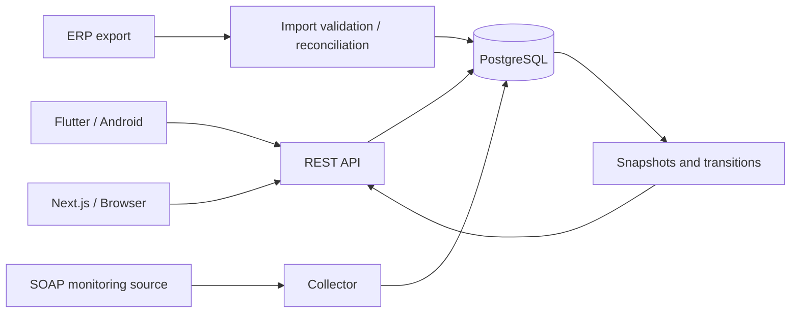

# Architecture & system boundaries

This diagram is a **high-level, non-deployable representation**.

## Components

| Component | Responsibility |
| --- | --- |
| Flutter client | Device search, status details, location-aware problem map, revalidation actions |
| Next.js web | Dashboard, equipment search, reporting and controlled user administration |
| FastAPI service | Endpoint contracts, authorization and orchestration of data operations |
| PostgreSQL 15 | Current inventory, resolved identifiers, monitoring views and transition history |
| Collector/integration jobs | Retrieve and reconcile data from monitoring SOAP services and ERP exports |
| Cloud operations | Host service workloads and connect them to controlled infrastructure |
| Windows/PowerShell automation | Directory-related workflows and scheduled processing where required |

## Conceptual data path

1. An ERP export supplies the expected inventory.
2. SOAP integration supplies monitoring information and counters where available.
3. Validation/reconciliation normalizes records and avoids unreviewed reactivations.
4. Database views present current status; snapshot/transition workflows preserve relevant changes.
5. Backend endpoints expose scoped operations to authenticated clients.
6. Frontends show summary indicators, device records, and problematic locations.

## Security and constraints

- Application passwords are hashed; never store plain-text passwords.
- Administrative and technician permissions are separate, but **technician is not equivalent to customer-scoped access** in the documented design.
- Sensitive endpoints require backend authorization, not only hidden buttons.
- Public browser and mobile clients do not receive database credentials.
- Cloud identifiers, addresses, instance names, ports, infrastructure topology and secrets are intentionally excluded.

## Performance considerations

A full-fleet map can lead to poor response and rendering performance. The field map instead focuses on locations with a problem and renders a capped subset nearest to the technician. This is a product-specific trade-off, not a replacement for server-side pagination for all endpoints.

## Scope
This is an architectural explanation, not deployment instructions. It is **not** intended to recreate proprietary monitoring integrations or disclose the employer's infrastructure.
